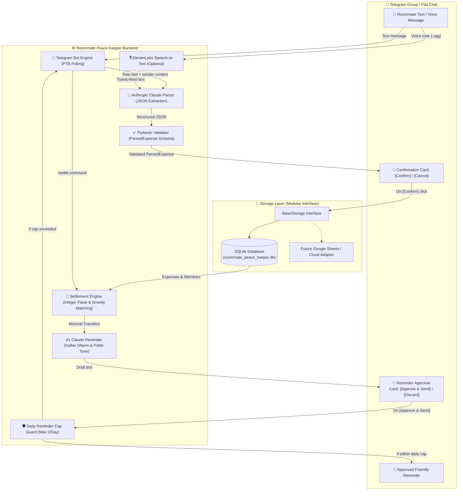

# 🏠 Roommate Peace Keeper ✌️
> *Because splitting bills shouldn't split friendships.*

[](https://www.python.org/)
[](https://opensource.org/licenses/MIT)
[](https://github.com/shravyad05/roommate-peace-keeper)

A conversational Telegram bot where roommates log shared expenses in plain English. Powered by **Anthropic Claude**, it parses conversational messages into validated financial ledgers, calculates the mathematical minimum number of repayments, and drafts warm, polite, non-nagging payment reminders that are **strictly gated by human approval**.

---

## 🏆 Ideathon & Team Details

- **Event:** wHACKiest 2026 Ideathon
- **Team Name:** Team Lumen
- **Project ID:** `7974a5e3`
- **Track:** Track 1
- **Institution:** Sapthagiri NPS University
- **Team Members:**
  - **Shravya.D** ([@shravyad05](https://github.com/shravyad05))
  - **Shreya.V.Hegde**

---

## 📌 Problem Statement

Living with flatmates is fun until shared expenses enter the equation:
1. **The Friction of Standalone Apps:** Tools like Splitwise require every flatmate to install an app, create an account, navigate multi-step forms, and update bills manually. As a result, bills get forgotten.
2. **The Passive-Aggressive WhatsApp Group:** People resort to messy WhatsApp messages or shared Google Sheets. But asking a friend for money feels awkward, leading to delayed payments, simmering resentment, or embarrassing public confrontation.
3. **Complex Debt Chains:** If Alice owes Bob ₹200 and Bob owes Charlie ₹200, two separate UPI payments are made with double transaction fees/friction, when Alice could have simply paid Charlie once.
4. **Rogue AI Bots & Spam:** Traditional bots spam groups with robotic, demanding payment alerts that embarrass flatmates and damage house harmony.

---

## 💡 Solution & Key Features

Roommate Peace Keeper meets flatmates right where they already chat: inside **Telegram**.

1. **🗣️ Natural Language Logging:** Type casually like you talk to a friend:
   - *"Paid 600 for dinner, split 3"*
   - *"Ravi paid 300 for wifi, split between me, Ravi and Anu"*
   - *"1500 for Blinkit groceries, split all"*
2. **🛡️ Interactive Confirmation Cards:** Claude parses text into structured JSON validated by Pydantic. The bot responds with an inline card showing payer, amount, item, and per-head split with `[✅ Confirm]` and `[❌ Cancel]` buttons. **Nothing is saved to the ledger without confirmation.**
3. **👥 Dynamic Member Management (`/members`):** Track flatmates with `/members` and `/members add <Name1>, <Name2>`.
4. **📊 Real-Time Net Balances (`/balances`):** View clean balance positions: 🟢 who is owed money (+₹), 🔴 who owes money (-₹), and ⚪ who is settled.
5. **🧮 Minimum-Transfer Settlement (`/settle`):** Pure greedy debt simplification algorithm that reduces $N$-person debt cycles to the minimum required transfers without any paise drift.
6. **🕊️ Empathetic Reminders with a Human Approval Gate:** Claude crafts short, warm, non-nagging drafts for each debt. **Crucially, nothing is ever broadcast without explicit user click on `[🚀 Approve & Send]`.**
7. **🚫 Built-In Daily Anti-Spam Cap:** SQLite tracks approved reminders per debtor. A configurable daily cap (default 2/day) strictly prevents nagging.
8. **🎙️ Optional Voice Note Transcription:** Integrated with ElevenLabs Speech-to-Text API. Roommates on the go can send voice notes; if configured, they are automatically transcribed and parsed.

---

## 🏗️ Architecture



---

## 🔄 User Flow

```mermaid
flowchart LR
    L1["1. Log"] --> L2["2. Parse"]
    L2 --> L3["3. Confirm"]
    L3 --> L4["4. Calculate"]
    L4 --> L5["5. Draft"]
    L5 --> L6["6. Approve & Send"]

    L1:::step -->|Plain English message| L2:::step
    L2 -->|Claude + Pydantic validation| L3:::step
    L3 -->|User clicks [Confirm]| L4:::step
    L4 -->|Greedy net balance simplification| L5:::step
    L5 -->|Claude warm reminder draft| L6:::step
    L6 -->|Human click + daily cap check| Done(("🕊️ Settled")):::done

    classDef step fill:#f0f4ff,stroke:#2563eb,stroke-width:2px,color:#1e3a8a;
    classDef done fill:#ecfdf5,stroke:#059669,stroke-width:2px,color:#065f46;
```

1. **Log:** Flatmate types *"Paid 600 for dinner, split 3"*.
2. **Parse:** Anthropic Claude extracts `payer: [Sender]`, `amount: 600.0`, `description: "Dinner"`, `participants: [3 members]`.
3. **Confirm:** An interactive card shows exact breakdown. User taps `[✅ Confirm]`.
4. **Calculate:** Running `/settle` simplifies all debts into the minimal pairwise payments.
5. **Draft:** Claude composes an empathetic reminder (e.g., *"Hey Ravi! Whenever you have a sec, could you send ₹200 for dinner? No rush, UPI works! 😊"*).
6. **Approve & Send:** Flatmate reviews the message and clicks `[🚀 Approve & Send]`. Only then is it delivered.

---

## 💻 Tech Stack & Design Decisions

| Component | Technology | Rationale |
|---|---|---|
| **Runtime** | Python 3.11+ | High reliability, native asynchronous I/O support, modern typing. |
| **Bot Framework** | `python-telegram-bot` v22+ (Polling) | Battle-tested, supports inline keyboard callbacks, no public webhook/domain required for hackathon demos. |
| **LLM & Reasoning** | Anthropic Claude (`claude-3-5-sonnet` / `CLAUDE_MODEL`) | Unrivaled JSON adherence, nuanced empathetic text drafting, and context awareness. |
| **Data Validation** | Pydantic v2 | Guarantees strict types (`amount > 0`, non-empty participants, title-casing, deduplication). |
| **Storage Backend** | SQLite behind `BaseStorage` | Zero-configuration single-file database for MVP; clean interface enables plugging in Google Sheets or DynamoDB without changing business logic. |
| **Speech-to-Text** | ElevenLabs Speech-to-Text API | State-of-the-art multilingual transcription for voice notes, gracefully skipped if API key is not present. |
| **Settlement Math** | Pure Integer Paise Greedy Algorithm | Zero floating-point roundoff drift; proven mathematically to terminate in at most $N-1$ transactions. |

---

## ⚡ Novelty vs Existing Tools

| Feature | Splitwise | WhatsApp + Shared Sheet | **Roommate Peace Keeper** |
|---|---|---|---|
| **Interface** | Separate app to download & open | Spreadsheet app + messaging | **Inside your existing Telegram group** |
| **Input Effort** | Fill 5+ form fields per expense | Manual row entry & formula maintenance | **1 natural sentence: _"Paid 600 for dinner, split 3"_** |
| **Approval Gate** | None (instant notification spam) | Manual copy-paste | **Human-in-the-loop: [Approve & Send] vs [Discard]** |
| **Tone of Reminders** | Robotic / transactional notification | Awkward personal confrontation | **Claude AI warm, polite, non-nagging drafts** |
| **Anti-Spam Protection** | Daily email digests (ignored) | None | **Strict database-enforced daily cap (max 2/day)** |
| **Math Integrity** | Proprietary algorithm | Broken formulas / cell overwrites | **Pure integer paise arithmetic + greedy solver** |

---

## 🛡️ Risks & Solutions

| Risk | Impact | Peace Keeper Fix |
|---|---|---|
| **Wrong LLM Parse** | Incorrect amounts or participants saved to ledger | **Confirmation Card Gate:** Bot never writes to the database until user clicks `[Confirm]`. Shows clear itemized breakdown first. |
| **Spammy / Demanding Bot** | Annoyed flatmates, awkwardness, bot kicked from group | **Approval Gate & Daily Cap:** Bot never messages anyone autonomously. Reminders require human click, and SQLite blocks >2 reminders/day per debtor. |
| **Data Privacy & Leakage** | Financial details exposed outside group | **Group-Scoped Local Storage:** All records are keyed strictly to `group_id`. No cross-group exposure. Works completely offline with SQLite. |
| **Network / API Dropouts** | Claude API rate limit or outage stalls the group | **Deterministic Heuristic Fallback:** Built-in regex fallback parser & template engine ensures logging and settling work even if external APIs are unreachable. |

---

## 🚀 Step-by-Step Setup and Run Instructions

### 1. Clone & Enter Repository
```bash
git clone https://github.com/shravyad05/roommate-peace-keeper.git
cd roommate-peace-keeper
```

### 2. Set Up Virtual Environment (Recommended)
```bash
python -m venv venv
# On Windows:
venv\Scripts\activate
# On Linux/macOS:
source venv/bin/activate
```

### 3. Install Dependencies
```bash
pip install -r requirements.txt
```

### 4. Configure Environment Variables
Copy `.env.example` to `.env`:
```bash
cp .env.example .env
```
Open `.env` and fill in your keys:
```env
# Required for Telegram bot
TELEGRAM_BOT_TOKEN=your_telegram_bot_token_here

# Required for Claude natural language parsing and reminder drafting
ANTHROPIC_API_KEY=your_anthropic_api_key_here
CLAUDE_MODEL=claude-3-5-sonnet-20241022

# Optional: For voice note transcription (skip or leave blank if not using)
ELEVENLABS_API_KEY=

# Settings
DATABASE_PATH=roommate_peace_keeper.db
DAILY_REMINDER_CAP=2
```
> *Tip: Obtain a Telegram bot token in 30 seconds by messaging `@BotFather` on Telegram.*

### 5. Run the Test Suite
Verify that all 11 unit and integration tests pass:
```bash
python -m pytest tests -v
```

### 6. (Optional) Seed Demo Data
Populate realistic roommates and sample bills to preview `/balances` and `/settle`:
```bash
python scripts/seed.py
```

### 7. Start the Bot
Run the bot in polling mode:
```bash
python -m app.bot
```
The console will display:
```text
🚀 Starting Roommate Peace Keeper Bot (polling mode)...
✅ Bot is online and listening for messages. Press Ctrl+C to stop.
```

---

## 💬 Example Conversation Walkthrough

```text
Roommate A:
"Paid 600 for dinner, split between Ravi, Anu and me"

Peace Keeper Bot:
🧾 Confirm Expense Details
💳 Payer: Roommate A
💰 Total Amount: ₹600.00
📝 Description: Dinner
👥 Split Between (3): Roommate A, Ravi, Anu
💸 Share Per Person: ₹200.00
Is this correct? Click Confirm to save to ledger.
[✅ Confirm]  [❌ Cancel]

(Roommate A clicks [✅ Confirm])

Peace Keeper Bot:
✅ Expense #1 Saved to Ledger!
💳 Roommate A paid ₹600.00 for Dinner
👥 Split among: Roommate A, Ravi, Anu (₹200.00 each)
Check /balances to see updated balance sheet.

---

Roommate B:
/balances

Peace Keeper Bot:
📊 Current Net Balances:
🟢 Roommate A: +₹400.00 (is owed money)
🔴 Anu: -₹200.00 (owes money)
🔴 Ravi: -₹200.00 (owes money)

💡 Type /settle to see the minimal settlement plan.

---

Roommate B:
/settle

Peace Keeper Bot:
🤝 Minimal Settlement Plan:
• Anu ➔ pays ➔ Roommate A: ₹200.00
• Ravi ➔ pays ➔ Roommate A: ₹200.00

🕊️ Peace Keeper Reminder Drafts:
Polite, non-nagging drafts prepared below. Nothing is sent without approval:

📨 Draft for Anu (from Roommate A for ₹200.00):
💬 "Hey Anu! Whenever you get a minute, could you send ₹200.00 for the dinner split? No rush at all, UPI works! 😊"
[🚀 Approve & Send]  [🗑️ Discard]

(Roommate A reviews and clicks [🚀 Approve & Send])

Peace Keeper Bot:
🕊️ Reminder from Roommate A to Anu:
💬 "Hey Anu! Whenever you get a minute, could you send ₹200.00 for the dinner split? No rush at all, UPI works! 😊"
(Sent with human approval • Reminder 1/2 today)
```

---

## 🔮 Future Scope & Roadmap

1. **📋 Chores Rota & House Tasks:** Intelligent schedule rotation for cleaning, trash duties, and cooking with AI swaps.
2. **📊 Google Sheets Two-Way Sync:** Plug-in storage module to mirror SQLite records directly into a live Google Sheet.
3. **💳 One-Click UPI Links & QR Codes:** Generate dynamic `upi://pay?pa=...&am=...` links so debtors can pay with 1 tap via GPay/PhonePe.
4. **🟢 WhatsApp Business API Integration:** Extend the bot beyond Telegram to WhatsApp groups via Twilio or Meta Cloud API.
5. **🧾 OCR Receipt & Invoice Scanning:** Upload supermarket receipts or food delivery bills; Claude vision extracts line items automatically.
6. **🏢 PG & Apartment Owner Dashboard:** A web dashboard for landlords to track consolidated rent, electricity meter readings, and maintenance dues.
7. **☁️ Production AWS / Serverless Deployment:** Containerized Docker deployment on AWS ECS Fargate or Lambda webhook with DynamoDB persistence.

---

## 📄 License

This project is licensed under the MIT License - see the [LICENSE](LICENSE) file for details. Built with ❤️ for **wHACKiest 2026**.
